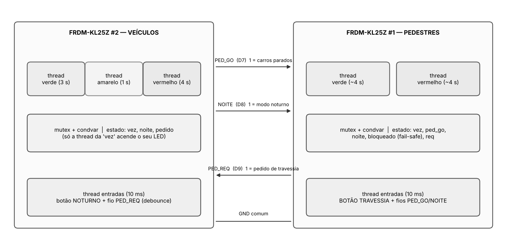
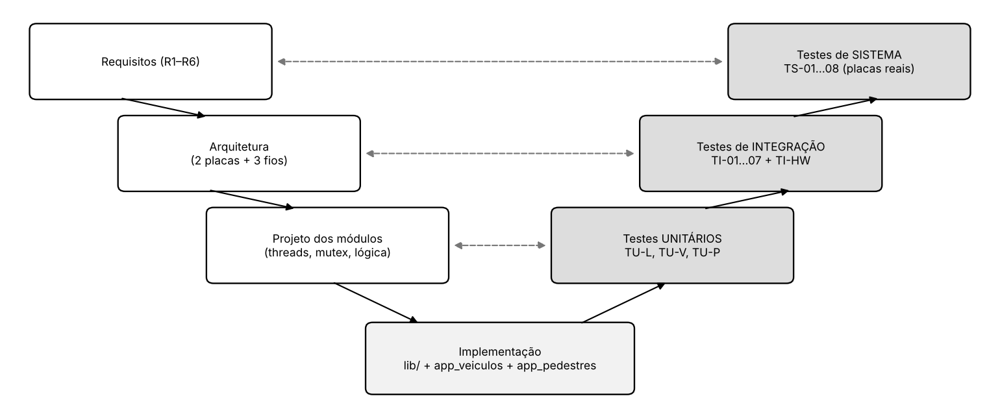
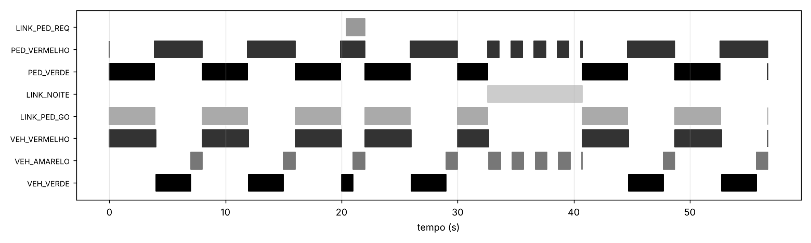

# Aula 07 — Semáforos de Pedestres e Veículos (Zephyr / FRDM-KL25Z)

**PSI – Microcontroladores 2** · Artur Serejo Dantas (Nº USP 15441730) · Repositório: [URL]

## 1. Requisitos

| ID | Requisito |
|---|---|
| R1 | Pedestre: verde 4 s / vermelho 4 s, 2 threads com mutex (placa 1) |
| R2 | Veículos: verde 3 s / amarelo 1 s / vermelho 4 s, 3 threads com mutex (placa 2) |
| R3 | Nunca 2 LEDs do mesmo semáforo acesos; pedestre verde só com carro vermelho |
| R4 | Noturno: carro amarelo e pedestre vermelho piscando 1 s / 1 s |
| R5 | Botão: ativa pedestre verde, carros param com segurança (V → A → Vm) |
| R6 | Segurança (projeto): cabo solto ou preso → pedestre vermelho |

## 2. Hardware

| Sinal | Placa VEÍCULOS | Placa PEDESTRES |
|---|---|---|
| LEDs (330 Ω p/ GND) | V PTD4 · A PTA12 · Vm PTA5 | V PTD4 · Vm PTA12 |
| Botão (p/ GND, pull-up) | PTC8 — modo noturno | PTC8 — travessia |
| PED_GO / NOITE / PED_REQ | PTC9 → / PTA13 → / PTD5 ← | PTC9 ← / PTA13 ← / PTD5 → |

Fios entre placas: D7–D7, D8–D8, D9–D9 e GND (1 kΩ em série). Entradas com pull-down: fio solto = 0 = pedestre vermelho.

## 3. Arquitetura

{width=78%}

- **Uma thread por LED** + uma thread de entradas por placa (leitura a cada 10 ms com debounce).
- **Exclusão mútua:** um `k_mutex` protege o estado e os LEDs. A variável `vez` funciona como token: cada thread espera em `k_condvar_wait()` até ser a sua vez, e a vez só passa depois que o LED apaga. As esperas liberam o mutex, então a thread de entradas pode interromper o verde a qualquer momento.
- **Sincronismo:** a placa de veículos é a mestre. `PED_GO = 1` sobe depois que o vermelho acende e cai 100 ms antes de ele apagar (intervalo em que todos ficam vermelhos). Por isso o pedestre fica verde ≈ 3,9 s e vermelho ≈ 4,1 s, com o mesmo ciclo de 8 s.
- **Botão:** gera `PED_REQ`. O verde dos carros cai para no mínimo 1 s e segue V → A (1 s) → Vm. O pedido é ignorado no vermelho e no modo noturno.
- **Noturno:** entra sempre pelo amarelo e sai pelo vermelho dos carros.
- **Fail-safe:** se `PED_GO` ficar preso em 1, o verde do pedestre apaga em 4,3 s e só reabre depois que o fio voltar a 0.
- **Testabilidade:** a HAL tem duas versões. `hal_gpio.c` vai na placa. `hal_fake.c` vai nos testes: registra cada evento com horário e conta violações (2 LEDs do mesmo semáforo) e conflitos (pedestre verde com carro verde ou amarelo). O log serial `@ms SINAL valor` é verificado por `tools/analisa_log.py`.

## 4. Plano de testes — modelo V

{width=62%}

**Unitário:** a lógica pura e cada semáforo isolado, com as threads reais, a HAL fake e as entradas simuladas pelo teste (ztest). **Integração:** os dois semáforos na mesma imagem com os fios em software (ztest) e depois com os fios reais. **Sistema:** as 2 placas, com logs e vídeo. A tolerância de tempo é ±60 ms nos testes ztest e ±80 ms no hardware.

### 4.1 Unitários

| ID | Caso | Req. | Resultado esperado |
|---|---|---|---|
| TU-L01–03 | Sequência e durações | R2 | V→A→Vm→V; 3000/1000/4000 ms; no noturno sempre → A |
| TU-L04–08 | Regras de pedido e liberação | R3, R5 | verde com pedido = 1000 ms; pedido aceito só em V/A de dia; pedestre só com Vm |
| TU-L09–11 | Debounce | R5 | ruído < 3 amostras ignorado; 1 borda por mudança |
| TU-V01–02 | Partida e ciclo dos carros | R2 | começa no Vm; V 3000, A 1000, Vm 4000 ms, em ordem |
| TU-V03–04 | Exclusão e PED_GO | R3 | ≤ 1 LED aceso (amostra a cada 1 ms); PED_GO dentro do Vm, guarda ≥ 85 ms |
| TU-V05–07 | Pedido de travessia | R5 | verde = 1 s (pedido cedo) ou corte em ≤ 45 ms (pedido tarde); ignorado no Vm |
| TU-V08–10 | Noturno dos carros | R4 | A 1000/1000 ms, sem V/Vm, PED_GO = 0; saída → Vm → ciclo normal |
| TU-P01–04 | Ciclo do pedestre | R1, R3 | começa vermelho; segue PED_GO em ≤ 45 ms; V ≈ 3900, Vm ≈ 4100 ms |
| TU-P05–06 | Botão | R5 | PED_REQ em ≤ 55 ms, mantido até ser atendido; ignorado com pedestre verde |
| TU-P07, P02 | Fail-safe | R6 | fio solto: nunca abre; fio preso: apaga em 4300 ms e bloqueia |
| TU-P08–09 | Noturno do pedestre | R4 | Vm 1000/1000 ms; nenhum verde, mesmo com PED_GO = 1 |
| TU-V11, P10 | Contadores | R3 | 0 violações |

### 4.2 Integração

| ID | Caso | Req. | Resultado esperado |
|---|---|---|---|
| TI-01 | Sincronismo em 2 ciclos | R3 | todo verde do pedestre dentro do vermelho dos carros, folga ≥ 50 ms; 0 conflitos |
| TI-02/03 | Travessia de ponta a ponta | R5 | carros V 1 s → A 1 s → Vm; pedestre verde em ≤ 2,2 s; botão com pedestre verde ignorado |
| TI-04/05 | Noturno de ponta a ponta | R4 | os dois piscam 1 s, sem nenhum verde; na saída, ciclo normal |
| TI-06/07 | Estresse: botão a cada 450 ms por 20 s | R3, R5 | 0 conflitos, 0 violações |
| TI-HW | Fios reais + logs das 2 placas | R3 | `analisa_log.py` LOG-X01: 0 conflitos |

### 4.3 Sistema (placas reais)

| ID | Cenário | Req. | Resultado esperado |
|---|---|---|---|
| TS-01 | Modo dia, 2 min | R1–R3 | tempos corretos, nunca 2 LEDs acesos, sincronismo mantido |
| TS-02 | Botão no V (início e fim), no A e no Vm | R5 | sempre V → A → Vm antes do pedestre verde |
| TS-03/04 | Entrar no noturno em V, A e Vm; sair | R4 | piscante 1 s, sem verde; na saída, carros Vm |
| TS-05 | Soltar o fio PED_GO com o sistema rodando | R6 | pedestre vermelho e permanece |
| TS-06/07 | Resetar uma das placas | R3 | volta no vermelho e ressincroniza no ciclo seguinte |
| TS-08 | 10 min contínuos | R3 | `STATUS violacoes=0` nas duas placas |

## 5. Resultados

**Execução realizada:** simulação no PC (host). O mesmo código dos módulos e dos testes foi compilado com uma camada que emula a API do Zephyr (threads POSIX e tempo real). As evidências estão em `docs/evidencias/simulacao_host/`.

| Suíte | Casos | Aprovados |
|---|---|---|
| unit_logica | 11 | 11 |
| unit_veiculos | 11 | 11 |
| unit_pedestres | 10 | 10 |
| integracao | 7 | 7 |

Sessão de sistema simulada (~57 s, com botão e modo noturno), analisada por `analisa_log.py`: **15/15 verificações PASS**. Verde 3000 ms, amarelo 1000 ms e vermelho 4000 ms (±1 ms); guarda mínima de 99 ms; pisca 1000/1000 ms; latência do pedestre ≤ 1 ms (simulação); **0 violações e 0 conflitos** em 7 travessias.

**Pendente nas placas:** testes TI-HW e TS-01 a TS-08 (logs, vídeo) — [preencher após execução].

**Problema encontrado e corrigido:** o TU-V02 falhava porque o teste contava o amarelo do ciclo anterior. A correção foi analisar só os pulsos a partir do verde de referência (com margem de 20 ms para o atraso de detecção).

## 6. Desenvolvimento

Trabalho realizado individualmente, com as duas placas FRDM-KL25Z (placa 1: pedestres; placa 2: veículos). O histórico de commits no repositório registra as etapas: lógica → HAL → semáforo de pedestres → semáforo de veículos → testes de integração → ferramentas → relatório.
